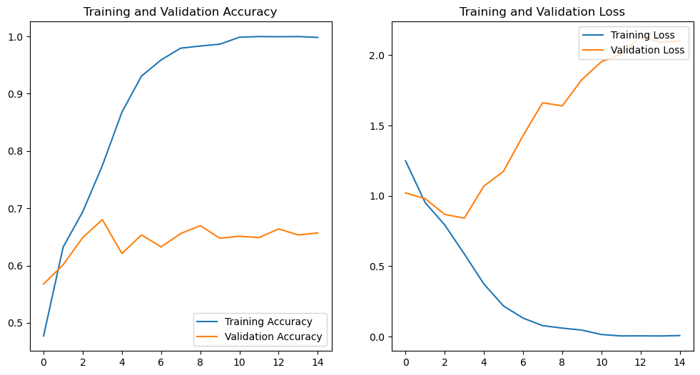
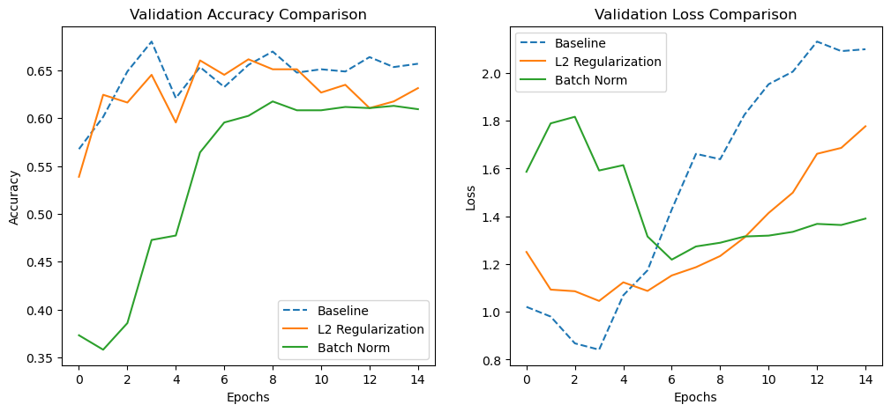
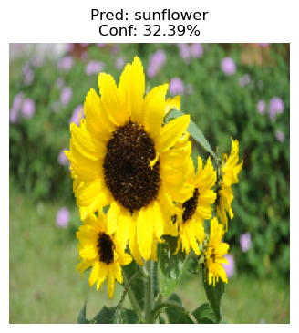
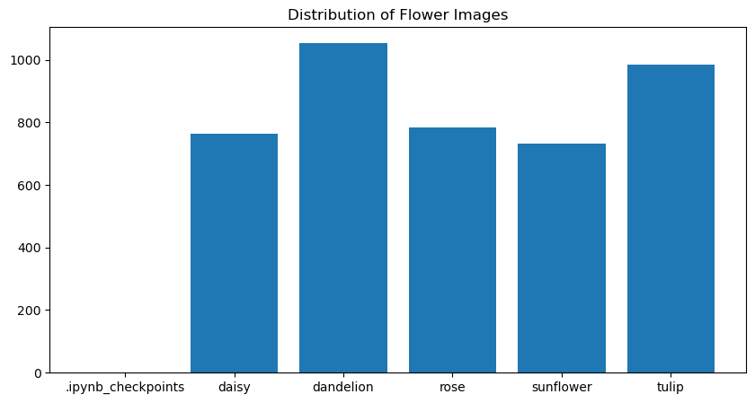

# Flowers CNN — 从基线到正则化改进

用 TensorFlow/Keras 做五类花卉的图像分类，重点不是"跑出一个准确率"，而是**看懂它为什么过拟合，再一步步压住**。

## 过程

1. **基线 CNN**：3 组 Conv-MaxPool，Adam + 稀疏交叉熵，训练 25 epoch。
2. **看曲线找问题**：训练准确率一路冲到 **0.9997**，验证准确率卡在 **0.65–0.68** 不动 —— 典型的过拟合。
3. **三组改进**：
   - L2 正则化（`kernel_regularizer`）
   - Dropout
   - 数据增强（旋转 / 平移 / 缩放 / 翻转，用 `ImageDataGenerator`）
4. **改进模型实测**：验证准确率 **76.01%**，比基线最好成绩（68.02%）高约 8 个点。

| 模型 | 训练准确率 | 验证准确率 |
|---|---|---|
| 基线 CNN | 0.9997 | 0.6802（最高） |
| 改进版（L2 + Dropout + 增强） | — | **0.7601** |

## 还做了什么

- **用自己的手机照片测试**：训练/验证集之外的图片，验证模型不是在记数据。
- 每一步都有 `history` 曲线对比图，能看出改进发生在哪一段。

## 结果图

`results/` 里 7 张图：类别分布、基线曲线、改进后曲线、两组模型对比、模型结构、自拍测试结果。

| | |
|---|---|
|  |  |
|  |  |

## 环境

```bash
pip install tensorflow numpy matplotlib opencv-python
```

数据集为五类花卉图片（`flowers/` 目录，未上传），notebook 里写了目录结构要求。
